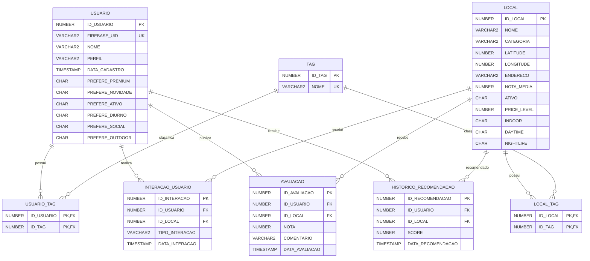

# AEON - Oracle PL/SQL e recomendacoes

## Arquitetura

A camada Oracle complementa o AEON com scoring deterministico e persistencia de historico de interacoes. Ela nao substitui Firebase Auth, Firestore nem as recomendacoes existentes no Flutter.

Fluxo Oracle:

```text
Flutter ou cliente REST
-> Spring Boot
-> JDBC
-> Oracle
-> Functions e Procedures PL/SQL
```

Fluxos preservados:

- Firebase Auth segue identificando usuarios no app.
- Firestore segue armazenando perfil, reviews, alertas, notificacoes e perfis profissionais.
- O backend Spring Boot expoe endpoints REST sem mover a regra de afinidade para Java.

## Evolucao Tecnica

O score combina tres fontes principais:

```text
Preferencias declaradas
+
Contexto/caracteristicas do local
+
Comportamento historico
```

Preferencias declaradas representam o que o usuario informa gostar no quiz/perfil. Historico representa o que ele efetivamente faz no app. Caracteristicas e tags descrevem os locais. Avaliacoes ajudam a identificar afinidade por categoria.

O Oracle atua como camada deterministica de scoring e persistencia. A function `FN_CALCULAR_AFINIDADE` aplica regras explicitas, auditaveis e reproduziveis, sem substituir outras camadas de recomendacao do AEON.

## Mapeamento Com Flutter

O modelo Oracle segue os conceitos ja existentes no Flutter:

| Flutter | Oracle |
| --- | --- |
| `RecommendationProfile.prefersPremium` | `USUARIO.PREFERE_PREMIUM` |
| `prefersNovelty` | `PREFERE_NOVIDADE` |
| `prefersActive` | `PREFERE_ATIVO` |
| `prefersDaytime` | `PREFERE_DIURNO` |
| `prefersSocial` | `PREFERE_SOCIAL` |
| `prefersOutdoor` | `PREFERE_OUTDOOR` |
| `preferredTags` | `USUARIO_TAG` |
| `Place.priceLevel` | `LOCAL.PRICE_LEVEL` |
| `Place.indoor` | `LOCAL.INDOOR` |
| `Place.daytime` | `LOCAL.DAYTIME` |
| `Place.nightlife` | `LOCAL.NIGHTLIFE` |
| `Place.tags` | `LOCAL_TAG` |

Booleanos foram modelados como `CHAR(1)` com valores `S` e `N`.

## Modelo De Dados



### Tabelas

- `USUARIO`: vincula `FIREBASE_UID` ao usuario Oracle e armazena preferencias estruturadas.
- `LOCAL`: representa locais do AEON com categoria, coordenadas, nota, status e caracteristicas usadas no score.
- `TAG`: catalogo normalizado de tags.
- `USUARIO_TAG`: relacionamento N:N entre usuarios e tags preferidas.
- `LOCAL_TAG`: relacionamento N:N entre locais e tags.
- `INTERACAO_USUARIO`: registra `VISUALIZOU`, `CURTIU`, `SALVOU`, `VISITOU` e `IGNOROU`.
- `AVALIACAO`: armazena notas e comentarios por usuario/local.
- `HISTORICO_RECOMENDACAO`: armazena recomendacoes geradas por score.

Constraints principais:

- PKs e FKs em todas as relacoes.
- `UNIQUE` em `USUARIO.FIREBASE_UID`, `TAG.NOME` e `HISTORICO_RECOMENDACAO(ID_USUARIO, ID_LOCAL)`.
- Checks para flags `S/N`, nota, status, faixa de preco e tipos de interacao.

### Dados Simulados

O arquivo `aeon-backend/database/oracle/02_seed.sql` cria usuarios exclusivamente para testes e demonstracoes do algoritmo. Eles nao representam contas reais do aplicativo.

- `Blair Willow` (`ID_USUARIO = 1`, `FIREBASE_UID = uid-demo-blair`): perfil social, noturno, premium, gastronomico e musical. Tags associadas: `gastronomy`, `music`, `social`, `night` e `premium`.
- `Ken` (`ID_USUARIO = 2`, `FIREBASE_UID = uid-demo-ken`): perfil outdoor, diurno, ativo, natureza e cultura. Tags associadas: `nature`, `culture`, `outdoor`, `day` e `active`.

Esses dados permitem comparar a mesma localizacao para perfis diferentes. Por exemplo, um local gastronomico, social e noturno tende a pontuar melhor para Blair Willow; um parque ou local outdoor, diurno e ativo tende a pontuar melhor para Ken.

## Regra De Score

`FN_CALCULAR_AFINIDADE(p_id_usuario, p_id_local)` retorna `NUMBER` entre 0 e 100. Retorna 0 quando o usuario nao existe, o local nao existe ou o local esta inativo.

Distribuicao:

- Tags compativeis: ate 30 pontos. Cada tag comum entre `USUARIO_TAG` e `LOCAL_TAG` soma 10 pontos, limitado a 30.
- Preferencias contextuais: ate 25 pontos. Soma 5 pontos por compatibilidade entre preferencia e local:
  - premium com `PRICE_LEVEL >= 3`;
  - diurno com `DAYTIME = 'S'`;
  - outdoor com `INDOOR = 'N'`;
  - social com tag `social`;
  - ativo com tag `active`;
  - novidade com tag `new`.
- Historico positivo da categoria: ate 20 pontos. Interacoes `CURTIU`, `SALVOU` e `VISITOU` em locais da mesma categoria somam 5 pontos cada, limitado a 20. Interacoes `IGNOROU` na mesma categoria reduzem discretamente esse bloco.
- Interacao direta com o local: ate 10 pontos. Interacoes positivas com o proprio local somam 5 pontos cada, limitado a 10. Visualizacao simples nao entra como preferencia forte.
- Avaliacoes anteriores: ate 15 pontos. A media de notas do usuario na mesma categoria e convertida proporcionalmente para 15 pontos.

## Functions

### `FN_CALCULAR_AFINIDADE`

Arquivo: `aeon-backend/database/oracle/03_functions.sql`

Parametros:

- `p_id_usuario IN NUMBER`
- `p_id_local IN NUMBER`

Retorno:

- `NUMBER`, de 0 a 100.

Exemplo:

```sql
SELECT
    l.nome,
    fn_calcular_afinidade(1, l.id_local) AS afinidade
FROM local l
WHERE l.ativo = 'S'
ORDER BY afinidade DESC;
```

### `FN_RESUMO_LOCAL`

Arquivo: `aeon-backend/database/oracle/03_functions.sql`

Parametro:

- `p_id_local IN NUMBER`

Retorno:

- `VARCHAR2`

O resumo inclui nome, categoria, nota, faixa de preco, ambiente, periodo e quantidade de avaliacoes.

Exemplo:

```sql
SELECT fn_resumo_local(1) AS resumo
FROM dual;
```

### `FN_CLASSIFICAR_AFINIDADE`

Arquivo: `aeon-backend/database/oracle/03_functions.sql`

Parametro:

- `p_score IN NUMBER`

Retorno:

- `VARCHAR2`

Converte o score numerico de afinidade em uma classificacao textual simples: `BAIXA`, `MEDIA` ou `ALTA`. Valores nulos retornam `NAO_CALCULADA`; valores fora do intervalo de 0 a 100 retornam `INVALIDA`.

Essa function facilita a interpretacao do indicador e demonstra reutilizacao entre functions, combinando o resultado de `FN_CALCULAR_AFINIDADE` com uma classificacao textual.

Exemplo:

```sql
SELECT fn_classificar_afinidade(85) AS classificacao
FROM dual;
```

Exemplo combinado:

```sql
SELECT
    l.nome,
    fn_calcular_afinidade(1, l.id_local) AS score,
    fn_classificar_afinidade(
        fn_calcular_afinidade(1, l.id_local)
    ) AS classificacao
FROM local l
WHERE l.ativo = 'S'
ORDER BY score DESC;
```

## Procedures

### `PR_REGISTRAR_INTERACAO`

Arquivo: `aeon-backend/database/oracle/04_procedures.sql`

Parametros:

- `p_id_usuario IN NUMBER`
- `p_id_local IN NUMBER`
- `p_tipo_interacao IN VARCHAR2`

Valida usuario, local ativo e tipo de interacao. Normaliza o tipo com `UPPER(TRIM(...))` e registra em `INTERACAO_USUARIO`. Usa `IF`, `EXCEPTION` e `RAISE_APPLICATION_ERROR`.

### `PR_GERAR_RECOMENDACOES`

Arquivo: `aeon-backend/database/oracle/04_procedures.sql`

Parametro:

- `p_id_usuario IN NUMBER`

Fluxo:

```text
CURSOR locais ativos
-> LOOP
-> FN_CALCULAR_AFINIDADE
-> IF score >= 55
-> MERGE HISTORICO_RECOMENDACAO
-> DELETE recomendacoes antigas abaixo do threshold
```

O threshold foi ajustado para 55 porque a nova funcao tem mais fontes de pontuacao. Esse limite exige mais do que um sinal isolado: em geral, o usuario precisa ter combinacao de tags, preferencias contextuais e/ou comportamento historico.

### `PR_ATUALIZAR_NOTA_MEDIA_LOCAL`

Arquivo: `aeon-backend/database/oracle/04_procedures.sql`

Parametro:

- `p_id_local IN NUMBER`

Recalcula e consolida a nota media de um local a partir da tabela `AVALIACAO`. A procedure valida se o local existe, calcula `AVG(AVALIACAO.NOTA)` para o local informado e atualiza `LOCAL.NOTA_MEDIA`. Quando o local nao possui avaliacoes, a media consolidada passa a ser `0`.

Essa rotina mantem consistencia entre:

```text
AVALIACAO.NOTA
```

e:

```text
LOCAL.NOTA_MEDIA
```

Ela pode ser usada como rotina interna de manutencao apos novas avaliacoes, sem exigir novo endpoint REST.

## Integracao Java

Fluxo implementado:

```text
REST
-> Controller
-> Service
-> Repository JDBC
-> Oracle
-> PL/SQL
```

Endpoints:

- `POST /api/interactions`
- `GET /api/recommendations/{firebaseUid}`

Arquivos Java:

- `InteractionController`
- `RecommendationController`
- `OracleRecommendationService`
- `OracleRecommendationRepository`
- `InteractionRequest`
- `InteractionResponse`
- `RecommendationResponse`

O backend resolve `firebaseUid` para `ID_USUARIO` antes de chamar procedures. A regra de score permanece no Oracle.

## Execucao

Variaveis:

```text
ORACLE_URL=jdbc:oracle:thin:@//localhost:1521/FREEPDB1
ORACLE_USER=AEON
ORACLE_PASSWORD=sua_senha
ORACLE_DRIVER=oracle.jdbc.OracleDriver
```

Sem essas variaveis, o backend continua usando H2 em memoria para os fluxos existentes.

Ordem dos scripts:

```sql
@aeon-backend/database/oracle/01_schema.sql
@aeon-backend/database/oracle/02_seed.sql
@aeon-backend/database/oracle/03_functions.sql
@aeon-backend/database/oracle/04_procedures.sql
@aeon-backend/database/oracle/05_examples.sql
```

Rodar backend:

```powershell
cd aeon-backend
.\mvnw.cmd spring-boot:run
```

Registrar interacao:

```bash
curl -X POST http://localhost:8080/api/interactions \
  -H "Content-Type: application/json" \
  -d '{"firebaseUid":"uid-demo-blair","localId":3,"tipoInteracao":"SALVOU"}'
```

Consultar recomendacoes:

```bash
curl http://localhost:8080/api/recommendations/uid-demo-blair
```

## Exemplos De Apresentacao

Comparar locais para um usuario:

```sql
SELECT
    l.nome,
    fn_calcular_afinidade(1, l.id_local) AS afinidade
FROM local l
WHERE l.ativo = 'S'
ORDER BY afinidade DESC;
```

Comparar Blair Willow e Ken no mesmo local:

```sql
SELECT
    fn_calcular_afinidade(1, 1) AS blair,
    fn_calcular_afinidade(2, 1) AS ken
FROM dual;
```

Registrar uma interacao e observar impacto:

```sql
SELECT fn_calcular_afinidade(2, 7) AS score_antes FROM dual;

BEGIN
    pr_registrar_interacao(2, 7, 'SALVOU');
END;
/

SELECT fn_calcular_afinidade(2, 7) AS score_depois FROM dual;
```

Classificar o score de afinidade:

```sql
SELECT
    l.nome,
    fn_calcular_afinidade(1, l.id_local) AS score,
    fn_classificar_afinidade(
        fn_calcular_afinidade(1, l.id_local)
    ) AS classificacao
FROM local l
WHERE l.ativo = 'S'
ORDER BY score DESC;
```

Recalcular a nota media consolidada de um local:

```sql
SELECT id_local, nome, nota_media
FROM local
WHERE id_local = 1;

BEGIN
    pr_atualizar_nota_media_local(1);
END;
/

SELECT
    id_local,
    ROUND(AVG(nota), 2) AS media_avaliacoes
FROM avaliacao
WHERE id_local = 1
GROUP BY id_local;
```

Validar os objetos PL/SQL:

```sql
SELECT
    object_name,
    object_type,
    status
FROM user_objects
WHERE object_name IN (
    'FN_CALCULAR_AFINIDADE',
    'FN_RESUMO_LOCAL',
    'FN_CLASSIFICAR_AFINIDADE',
    'PR_REGISTRAR_INTERACAO',
    'PR_GERAR_RECOMENDACOES',
    'PR_ATUALIZAR_NOTA_MEDIA_LOCAL'
)
ORDER BY object_type, object_name;
```

